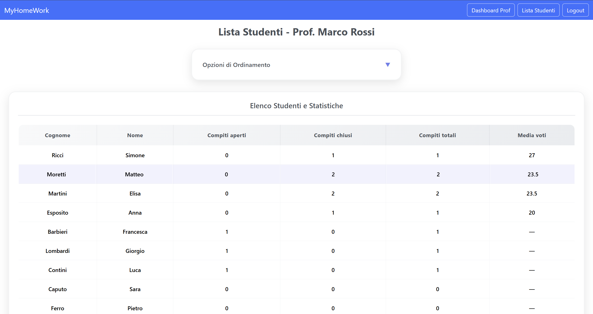
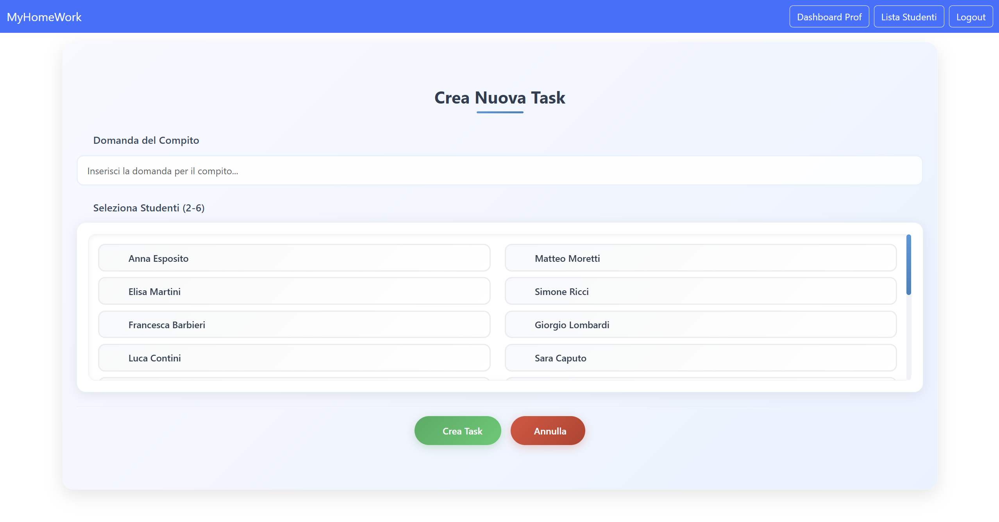

# Compiti: Group Assignment Manager

A full-stack web app where teachers create open-ended questions for groups of students, students answer them together, and teachers grade the answers.
I built it as an exam project for the *Web Applications I* course at Politecnico di Torino.

**Stack:** React 19 + Vite + React-Bootstrap (client) · Node.js + Express + Passport (server) · SQLite (database). The user interface is in Italian.




## Features

**Teachers**
- Create a task (question) and assign it to a group of 2–6 students.
- The app blocks groups in which two students have already worked together twice for the same teacher.
- See all their tasks, read the group's answer and give a grade (0–30). Grading closes the task.
- Browse the list of students with their average grade on the teacher's tasks, and sort it by several criteria.

**Students**
- See their open and closed tasks, and their overall average across all teachers.
- Write or edit the group's answer while the task is open, and see the grade once it is closed.

**Authentication:** session-based login with Passport (local strategy). Passwords are stored as salted hashes. Every API except login is restricted to authenticated users and checks the user's role and ownership of the resource.

## Getting started

Requirements: Node.js 20 or newer.

```bash
# 1. API server, on http://localhost:3001
cd server
npm install
node index.mjs

# 2. React client, in a second terminal, on http://localhost:5173
cd client
npm install
npm run dev
```

Then open http://localhost:5173 and log in with one of the [test accounts](#test-accounts).
The SQLite database (`server/compitidb.sqlite`) is included and already filled with sample data.

## Test accounts

| Role | Username | Password | Notes |
|------|----------|----------|-------|
| Teacher | `rossi.marco` | `passwordprof` | 2 closed tasks, 1 open |
| Teacher | `bianchi.lucia` | `passwordprof` | 1 closed task, 2 open |
| Student | `moretti.matteo` | `passwordstud` | Has already been in a group twice with `martini.elisa` for `rossi.marco`, so the pair is blocked |
| Student | `martini.elisa` | `passwordstud` | See above |

All 20 student accounts use the password `passwordstud`. The other usernames are:
`esposito.anna`, `ricci.simone`, `barbieri.francesca`, `lombardi.giorgio`, `contini.luca`, `caputo.sara`, `ferro.pietro`, `bianchi.marta`, `verdi.anna`, `neri.matteo`, `gialli.elisa`, `blu.simone`, `viola.francesca`, `marrone.giorgio`, `rosa.luca`, `grigi.sara`, `ferri.clara`, `greco.nicolo`.

## Project structure

```text
WebApp/
├── client/                 # React + Vite front end
│   └── src/
│       ├── App.jsx         # Routes and session state
│       ├── API/API.mjs     # fetch wrappers for the REST API
│       ├── components/     # Pages and UI components
│       ├── models/         # Client-side data models
│       └── styles/         # CSS
├── server/
│   ├── index.mjs           # Express app, auth, REST endpoints
│   ├── dao.mjs             # SQLite queries
│   ├── UTGModels.mjs       # Server-side data models
│   └── compitidb.sqlite    # Database with sample data
└── img/                    # Screenshots
```

## Client routes

| Route | Page |
|-------|------|
| `/` | Landing page with the login button (redirects to the user's home if already logged in) |
| `/login` | Login form |
| `/professore` | Teacher home: their tasks, with shortcuts to grade or create tasks |
| `/professore/listaStudenti` | Student overview with averages, sortable |
| `/professore/task/new` | Form to create a new task and pick the group |
| `/professore/task/:id/domanda` | Task detail: question, group members, answer, grading form |
| `/studente` | Student home: overall average, open and closed tasks |
| `/studente/task/:id/domanda` | Task detail: question, grade, answer editor while the task is open |
| `*` | Not found |

## Main React components

| Component | File | Role |
|-----------|------|------|
| `Home` | `Home.jsx` | Public landing page |
| `LoginForm` | `Login.jsx` | Login form |
| `UtenteHome` | `UtenteHome.jsx` | Home for teachers and students: statistics and task lists |
| `ProfListaStud` / `StudentiTable` | `ProfListaStud.jsx` | Sortable student table for teachers |
| `Domanda` | `Domanda.jsx` | Task detail page with grading and answer forms |
| `TaskForm` | `TaskForm.jsx` | New-task form: student selection and group validation |
| `NavHeader`, `DefaultLayout`, `NotFound` | | Layout and navigation |

## Database

| Table | Columns |
|-------|---------|
| `Utenti` | `id`, `username`, `pass` (hash), `salt`, `ruolo` (`insegnante` \| `studente`), `nome`, `cognome` |
| `Task` | `id`, `domanda`, `id_prof`, `stato` (`aperto` \| `chiuso`), `risposta`, `voto` (0–30), `dimensione_gruppo` (2–6) |
| `Gruppi` | `id_task`, `id_studente` (composite primary key) |

## REST API

Base URL: `http://localhost:3001/api`. Every endpoint except `POST /sessions` requires an authenticated session and returns `401` without one. `403` means the user is logged in but has the wrong role or does not own the resource. Unexpected errors return `500`.

### Sessions

| Method | Endpoint | Description | Responses |
|--------|----------|-------------|-----------|
| `POST` | `/sessions` | Log in with `{ "username", "password" }`. Returns the user (`id`, `username`, `nome`, `cognome`, `ruolo`) | `201`, `401` |
| `GET` | `/sessions/current` | Current user | `200`, `401` |
| `DELETE` | `/sessions/current` | Log out | `200` |

### Students

| Method | Endpoint | Description | Responses |
|--------|----------|-------------|-----------|
| `GET` | `/students` | All students (teachers only) | `200`, `403` |
| `GET` | `/students/:id` | One student | `200`, `404` |

### Tasks

| Method | Endpoint | Description | Responses |
|--------|----------|-------------|-----------|
| `GET` | `/tasks/:id` | One task (only its teacher or a member of its group) | `200`, `403`, `404` |
| `GET` | `/tasks/professor/:id` | All tasks of a teacher (only that teacher) | `200`, `403` |
| `GET` | `/tasks/student/:id` | All tasks of a student (only that student) | `200`, `403` |
| `POST` | `/tasks` | Create a task. Body below. Teachers only, for themselves | `201`, `400`, `403` |
| `PUT` | `/tasks/:id/vote` | Grade and close a task: `{ "voto": 28 }`. Only the owner, only if the task is open and answered | `200`, `400`, `403`, `404` |
| `PUT` | `/tasks/:id/risposta` | Save the group's answer: `{ "risposta": "..." }`. Only group members, only while the task is open | `200`, `400`, `403`, `404` |

A task looks like this:

```json
{ "id": 1, "domanda": "Qual è la capitale della Francia?", "id_prof": 1,
  "stato": "chiuso", "risposta": "Parigi", "voto": 20, "dimensione_gruppo": 3 }
```

Request body for `POST /tasks` (the response is `{ "id": 9 }`):

```json
{ "domanda": "Qual è la capitale della Francia?", "id_prof": 1,
  "dimensione_gruppo": 3, "studenti": [3, 4, 5] }
```

The request is rejected with `400` if the data is invalid or if any pair of students has already worked together twice for this teacher.

### Groups

| Method | Endpoint | Description | Responses |
|--------|----------|-------------|-----------|
| `GET` | `/groups/tasklist/:id` | Student ids of a task's group, e.g. `[3, 4, 5]` | `200`, `403`, `404` |
| `GET` | `/groups/verify?id_prof=&id_studente1=&id_studente2=` | `true` if the two students have already been in two groups together for this teacher | `200`, `400`, `403` |
| `POST` | `/groups` | Create the group for an existing task: `{ "id_task": 8, "id_studenti": [3, 4, 5] }`. Teachers only, for their own tasks | `201`, `400`, `403`, `404` |
